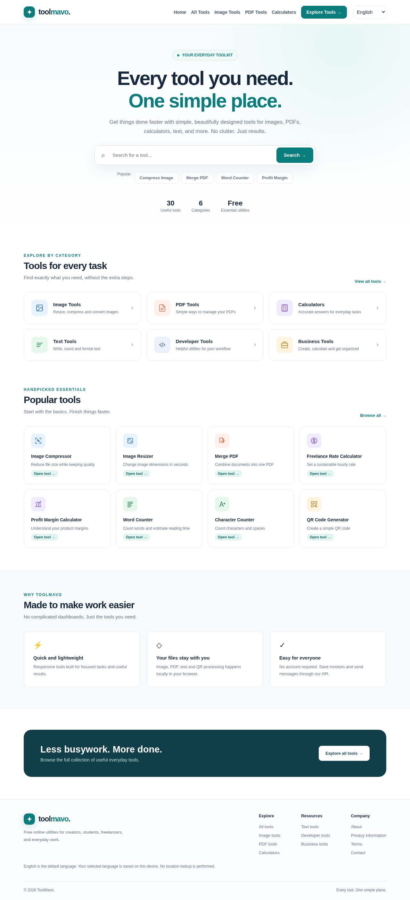

# ToolMavo

A responsive Vue 3 website with **Node.js / Express and MySQL**, adapted for Hostinger Node.js hosting. It includes all 30 tools from the supplied HTML layout, searchable categories, image/PDF downloads, invoice preview/save/print, and a database-backed contact form.



## Languages

The interface includes **12 built-in languages**: English, German, Urdu, Arabic, Hindi, Bengali, Simplified Chinese, Spanish, French, Portuguese (Brazil), Russian and Japanese. **English is the default for every new visitor**, regardless of browser language or country. The header selector remembers an explicit choice in local storage. If storage is blocked, selection still works for the current visit. No IP/location lookup, external translation API or service account is used.

Navigation, all 30 tool names/descriptions, instructions, labels, validation/status messages and generated calculator/counter results are translated. Urdu and Arabic use right-to-left layouts. Locale-specific numbers and invoice dates update with the selector. User text, files, URLs, QR contents, encodings and invoice currency are never automatically translated. Native file dialogs and browser form-validation messages follow browser/OS language.

Translations live in the eleven language JSON files under `frontend/src/locales/`. English interface messages are the lookup keys. Tests require both dictionaries to cover every catalog entry and template message, with matching interpolation placeholders. New languages should be added to the language registry and dictionaries together.

## Deploy on Hostinger

Follow [the Hostinger deployment guide](docs/DEPLOYMENT.md). Use the repository root as the application root, Node.js 24 (or 22.13+), `npm run build` as the build command, and `npm start` / `server/index.js` as the startup command/file. The server serves the Vue build and `/api` on the same domain.

A prebuilt upload package can be generated with:

```bash
npm ci
npm run build
npm run package:hostinger
```

Output: `artifacts/toolmavo-hostinger.zip`. It contains the Node server, source, lockfiles and built frontend, without database credentials or dependencies.

## Local development

Requires Node.js 22.13+ (24 recommended), npm, and MySQL 8.0+ / MariaDB compatible with the schema. Docker Compose uses MySQL 8.4.

```bash
npm ci
npm run build
# Start a local database; these passwords are for local testing only.
DB_PASSWORD=toolmavo_local MYSQL_ROOT_PASSWORD=toolmavo_local_root docker compose up -d db
DB_HOST=127.0.0.1 DB_NAME=toolmavo DB_USER=toolmavo DB_PASSWORD=toolmavo_local npm start
```

The application listens on port 8080 unless `PORT` is supplied. For live Vue development, run `npm run dev` inside `frontend`; Vite proxies `/api` to port 8080.

The app requires `DB_HOST`, `DB_NAME`, `DB_USER`, and `DB_PASSWORD`. Optional settings: `DB_PORT` (3306), `DB_SSL=true` (verified TLS), `NODE_ENV=production`, and `TRUST_PROXY_HOPS` (default 0; set only when your hosting proxy topology is confirmed). Set these through the hosting dashboard; `.env.example` is a reference, not an automatically loaded credentials file. Database credentials never belong in frontend variables.

Tables are created on startup with `CREATE TABLE IF NOT EXISTS`; the database user needs CREATE, SELECT and INSERT privileges. Startup fails if the database cannot be initialized. Existing tables are retained; future schema changes require explicit migrations. This version does not import historical PostgreSQL data.

## Tools

- **Image:** JPEG compression, resize, JPG→WebP, WebP→JPG, PNG→JPG, center crop. JPEG output composites transparency onto white. Dimensions up to 8192px and output up to 32 megapixels.
- **PDF:** merge in selection order, extract selected pages into one PDF, images→PDF, PDF→JPG, reorder, text watermark. Ranges such as `1,3-5,2` are supported. Encrypted PDFs are unsupported. JPG exports offer individual download buttons, up to 30 selected pages.
- **Calculator:** freelance rate, profit margin, markup, VAT added to net amount, discount and break-even.
- **Text/developer:** word and Unicode character counts, case conversion, deduplication, line comparison, JSON validation/formatting, Unicode Base64, URL encoding and UUID v4.
- **Business:** QR PNG downloads, invoices saved in MySQL and printable as PDF, UTM links preserving existing URL parameters.

Files, tool text and QR contents are processed locally in the browser. Only contact and invoice submissions are sent to the API. File limits: 25 MB each, 30 files, 100 MB combined. Contact messages are stored without email delivery; there is no admin inbox or account system.

See the [release test report](docs/TEST_REPORT.md), [German screenshot](docs/home-german-desktop.png), and [Urdu mobile screenshot](docs/home-urdu-mobile.png).

## Tests

```bash
npm test                  # HTTP API, validation, decimal rounding and security tests
npm run test:frontend     # utilities and localization tests
DB_HOST=127.0.0.1 DB_NAME=toolmavo DB_USER=toolmavo DB_PASSWORD=toolmavo_local npm run test:integration
# With the application already running:
cd frontend
TEST_BASE_URL=http://127.0.0.1:8080 npm run test:e2e
```

Browser tests require Chromium; set `CHROMIUM_PATH` if it is not `/usr/bin/chromium`. The MySQL integration test creates and deletes only its own uniquely identified test records. The API unit tests use an injected database stub; integration and browser tests exercise real MySQL.

## API and privacy

| Method | Path            | Result                                                                                         |
| ------ | --------------- | ---------------------------------------------------------------------------------------------- |
| GET    | `/api/health`   | Runs a database query; returns `UP` and `MySQL`                                                |
| POST   | `/api/contact`  | Validates and stores `{name,email,message}`                                                    |
| POST   | `/api/invoices` | Validates and stores `{client,email,description,quantity,rate,currency}` and returns a receipt |

Invoices use decimal arithmetic and HALF_UP rounding; currencies are USD, EUR, GBP, PKR. Rate and quantity support two decimals. Unknown fields, including a client-supplied total, are rejected. No public record-listing API exposes personal data. Submissions are limited to 30 per 15 minutes per client IP in each Node process, and API bodies to 32 KB. Configure proxy trust accurately to distinguish visitor IPs behind the host's proxy. For multiple processes, use host-level abuse controls or a shared rate-limit store.

## Cloud workspace

Use the existing isolated checkout at `/workspace/ToolMavo`; do not create another Git worktree unless asked. `scripts/cloud-install.sh` installs, builds and tests using workspace npm caches. `scripts/cloud-start.sh` starts local MySQL and the Node app. Live processes need restarting after restoration. Keep independent database backups.

## Launch details

Configure HTTPS, operator/legal contact information, data retention/deletion, database backups and support handling before collecting public submissions. Legal pages describe the implementation but need operator-specific review. A hosting plan is not proof that its Node.js deployment or database has been configured: follow the guide and verify the public URL. The original [layout prototype](design/layout.html) and [mobile screenshot](docs/home-mobile.png) are included. The previous Java/PostgreSQL and Render configurations have been retired from the active app.
